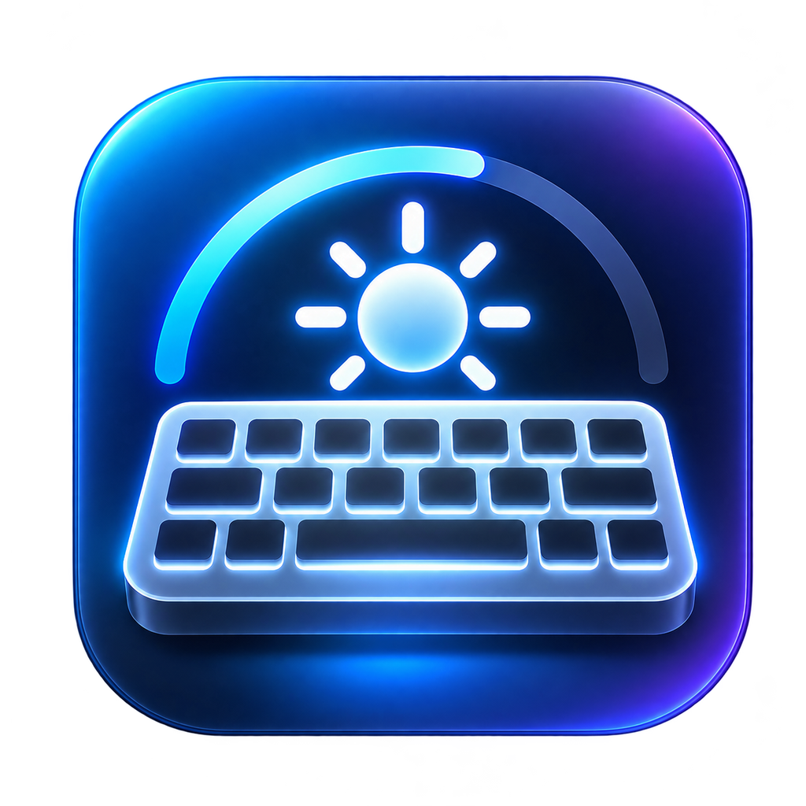

<p align="center">
  
</p>

<h1 align="center">Keyboard Backlight Utility</h1>

<p align="center">
  <strong>Control your Mac's keyboard brightness with global keyboard shortcuts.</strong>
</p>

<p align="center">
  A lightweight macOS menu-bar utility designed for quick, convenient keyboard backlight control.
</p>

<p align="center">
  
  
  
</p>

---

## Overview

**Keyboard Backlight Utility** provides convenient keyboard brightness controls directly from the macOS menu bar.

Designed to stay out of your way, it runs in the background without a conventional main window, allowing you to adjust your built-in keyboard's illumination using keyboard shortcuts.

## Features

- **Menu Bar Integration** — Access the utility directly from the macOS menu bar.
- **Global Keyboard Shortcuts** — Adjust keyboard brightness without switching applications.
- **Minimal Interface** — No unnecessary windows or interface clutter.
- **Quick Brightness Control** — Brighten or dim your keyboard using simple key combinations.
- **Lightweight Design** — Runs in the background for convenient access.
- **Native macOS Integration** — Uses the configured system mechanism for keyboard backlight control.

## Keyboard Shortcuts

| Action | Shortcut |
|:---|:---:|
| Dim keyboard backlight | `⌥ Option` + `↓` |
| Brighten keyboard backlight | `⌥ Option` + `↑` |

*Shortcuts require successful registration and compatible hardware and macOS support.*

## Requirements

- A Mac running macOS.
- A built-in keyboard with adjustable backlighting.
- Xcode to build and run the project.
- Compatible hardware and system support for keyboard brightness control.

## Installation

### 1. Clone the Repository

```bash
git clone <YOUR_REPOSITORY_URL>
cd KeyboardBacklightUtility
```

Replace `<YOUR_REPOSITORY_URL>` with your repository's clone URL.

### 2. Open the Project

```bash
open KeyboardBacklightUtility.xcodeproj
```

### 3. Build and Run

1. Open the project in Xcode.
2. Select the `KeyboardBacklightUtility` scheme.
3. Choose your Mac as the run destination.
4. Press **⌘ + R** to build and run.
5. Find the keyboard icon in the menu bar.
6. Try the configured brightness shortcuts.

## How It Works

The application runs as a macOS menu-bar utility and provides keyboard shortcuts for adjusting the built-in keyboard backlight.

When a supported shortcut is triggered, the application invokes its configured keyboard illumination control mechanism.

The implementation depends on the Mac model, macOS version, and available system interfaces.

### macOS Brightness Indicator

macOS may display its native keyboard brightness indicator when a brightness adjustment is processed.

This behavior is controlled by the operating system. Public macOS APIs do not provide a general mechanism for disabling this indicator while retaining normal system keyboard brightness behavior.

## Compatibility Notes

- Keyboard backlight controls vary across Mac models.
- Some Macs may not expose the expected keyboard illumination service.
- Global shortcut registration may have macOS-specific limitations.
- Undocumented system interfaces may change between macOS releases.
- Accessibility permission requirements depend on the shortcut implementation.

## Built With

| Technology | Purpose |
|---|---|
| Swift | Application development |
| Xcode | Build and development |
| macOS APIs | Operating system integration |
| Menu Bar Architecture | Background interface |

## Contributing

Contributions, bug reports, and suggestions are welcome.

1. Fork the repository.
2. Create a feature branch.
3. Make your changes.
4. Test on compatible Mac hardware.
5. Submit a pull request describing your changes.

When reporting an issue, include your Mac model, macOS version, and relevant error messages.

## License

This project is licensed under the **MIT License**. See the [`LICENSE`](LICENSE) file for details.

---

<p align="center">
  <strong>Simple controls. Less friction. A better macOS workflow.</strong>
</p>